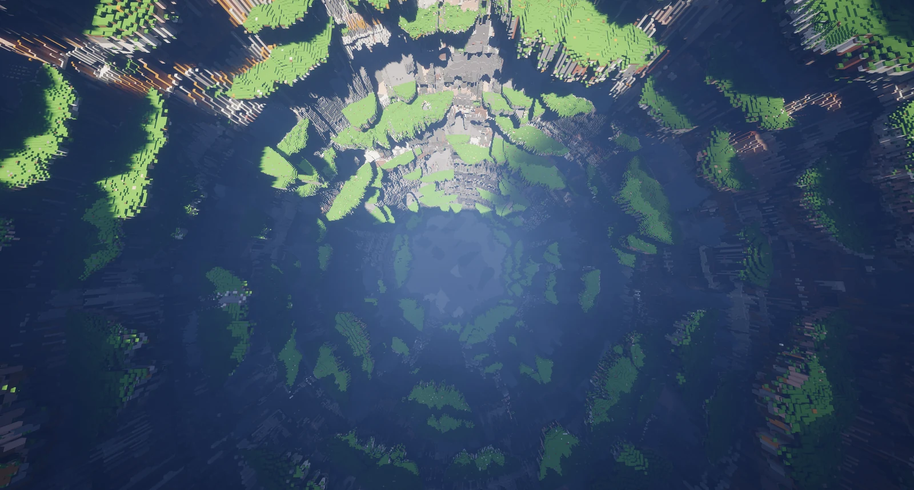
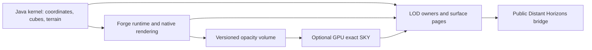

# Made in Abyss — Engine Probe

**An experimental continuous-depth Minecraft world, built on Forge with a 16³ cube runtime.**


The project explores an island and the Abyss in one continuous coordinate space: one block is one metre, and the shaft is centred at X=0, Z=0. A standalone Java kernel supplies addressing, versioned terrain sampling, cube storage, lighting, and LOD data; the Forge module connects those systems to Minecraft.

**This is a development prototype, not a finished adventure mod or a production server release.** The current landscape work focuses on the first layer. Full-depth engine experiments do not mean that every layer, survival system, or multiplayer scenario is complete. Source is visible under an [All Rights Reserved notice](LICENSE); this is not an open-source license.

[Current status](docs/public/status.md) · [Architecture](docs/public/architecture.md) · [Development](docs/public/development.md) · [Contributing](CONTRIBUTING.md) · [Milestone publishing](docs/public/publishing.md)



*B1 first-layer development world, axis-down, after GPU exact-light refinement. Gameplay capture with separately installed rendering integrations; not concept art.*

## What is implemented

| Area | Current implementation | Limits |
| --- | --- | --- |
| Continuous coordinates | Own 16³ cube addressing, persistence, residency, revisions, and Forge integration probes | Full-depth playable-world acceptance remains open |
| Terrain | Versioned procedural island and first-layer profiles, ledges, rock strata, caves, spires, arches, and supported water/cascade features | Historical and experimental profiles coexist; a declared feature is not an accepted ecosystem |
| Distant views | Custom surface/LOD construction and a bridge using the public Distant Horizons API | Optional integration; geometry readiness and acknowledged visible rendering are separate |
| Lighting | CPU exact light, provisional presentation, and an opt-in GPU exact SKY path | GPU mode needs a separately generated, authority-checked volume snapshot |
| GPU volume | Sparse 128 m page directory with 16³ opacity bricks, a closed exterior halo, and versioned cache metadata | Cold construction is still expensive; snapshots are not distributed here |
| Automation | A file-based client control interface for status, diagnostics, camera operations, and screenshots | Intended for isolated developer instances; not a public network service |

The GPU edit API currently contains unfinished integration work. Local block changes do **not** yet have an accepted incremental GPU-light path. GPU LOD meshing and the next flora stage are planned work, not shipped features.

## Requirements

| Component | Pinned target |
| --- | --- |
| Minecraft Java Edition | 1.20.1 |
| Forge | 47.4.20, required exactly by the current mod metadata |
| JDK | 17, including `java` and `javac` |
| Gradle | 8.8, supplied by the checked-in wrapper |
| ForgeGradle | 6.0.24 |
| Distant Horizons API | 7.2.0 at compile time |
| Optional Distant Horizons runtime | 3.3.3 for Minecraft 1.20.1 |
| Optional control tooling | Node.js; no npm packages are needed for the published control interface |
| Milestone publication tooling | Python 3.10+, Git, and Gitleaks 8.25+ |

The optional GPU-light worker requires OpenGL 4.6, GPU int64 and fp64 support, at least 16 compute SSBO bindings, and at least 128 MiB per SSBO. An RTX 4070 is the measured reference device. Other hardware has not been certified. Current B1 testing used roughly 589 MiB of explicitly allocated GPU buffers; that is not a complete process-VRAM measurement.

Development client settings default to an 8 GiB Java heap. Large worlds and optional render integrations need additional system memory. The commands below select G1 explicitly because availability of the project's experimental default GC depends on the JDK distribution.

## Player installation

There is no supported player-ready release attached to this initial source publication. Do not treat an arbitrary development JAR as a tested modpack.

If a future release includes a verified artifact, use the exact Minecraft/Forge versions named in that release and install optional dependencies separately from their official project pages. This repository does not redistribute Minecraft, third-party mod JARs, or shader packs. Keep experimental worlds separate from existing saves.

## Build from source

Install JDK 17 and set `JAVA_HOME` to that installation. The wrapper pins Gradle and its distribution checksum; a global Gradle installation is unnecessary.

PowerShell, from the repository root:

```powershell
.\scripts\gradle.ps1 -JdkPath $env:JAVA_HOME -Tasks @(':kernel:test')
.\scripts\gradle.ps1 -JdkPath $env:JAVA_HOME -Tasks @(':forge:build')
```

On Linux or macOS:

```sh
chmod +x gradlew
./gradlew --no-daemon :kernel:test
./gradlew --no-daemon :forge:build
```

Generated data goes under `.local/` by default and is ignored by Git. To use another disk, set `MIA_STORAGE_ROOT`, pass `-PmiaStorageRoot=...`, or create an ignored `local.properties` file containing `miaStorageRoot=...`. Use forward slashes in the properties file. See [storage precedence and detailed commands](docs/public/development.md).

The expected Forge artifact is `build/forge/libs/made-in-abyss-probe-<version>.jar` **inside the configured storage root**, not inside the checked-in `forge/` directory. The publication's current build and test results are recorded in [status](docs/public/status.md); a successful compilation is not a claim that all regression tests pass.

## Run an isolated development client

```powershell
.\scripts\gradle.ps1 -JdkPath $env:JAVA_HOME -Tasks @(':forge:runClient', '-PmiaClientGc=G1')
```

To enable the optional DH surface pipeline:

```powershell
.\scripts\gradle.ps1 -JdkPath $env:JAVA_HOME -Tasks @(':forge:runClient', '-PmiaClientGc=G1', '-PmiaDistantHorizons=true', '-PmiaDhLodPipeline=surfaces', '-PmiaDhSurfaceMesh=true')
```

The actual Forge run tasks create isolated development directories beneath the configured storage root. They do not install into a normal launcher profile. The [development guide](docs/public/development.md) distinguishes a standard userdev launch from the private acceptance fixtures used during development.

## Optional integrations

The flags below opt into pinned dependencies from Modrinth Maven. They do not embed those mods in this project's JAR.

| Gradle property | Effect |
| --- | --- |
| `-PmiaDistantHorizons=true` | Adds the unchanged official DH runtime |
| `-PmiaDhLodPipeline=surfaces` | Selects the independent surface pipeline; default is `legacy` |
| `-PmiaDhSurfaceMesh=true` | Enables the custom surface mesh renderer; default is `false` |
| `-PmiaAlexCaves=true` | Adds the pinned Alex's Caves and Citadel dependencies |
| `-PmiaShaderPipeline=true` | Adds the pinned Embeddium and Oculus dependencies |
| `-PmiaOptimizationMods=true` | Adds the pinned ModernFix, FerriteCore, and ImmediatelyFast dependencies |
| `-PmiaClientGc=G1` | Selects G1 instead of the experimental default Shenandoah configuration |

Shader packs are installed separately and are not included or licensed by this repository. Compatibility observations do not imply compatibility with every combination or version. See [integration details and exact dependency identifiers](docs/public/integrations.md).

## Architecture



Unknown cube or opacity data must remain unknown; it must not silently become air. Geometry, exact-light results, revisions, and renderer acknowledgement have separate authority checks. Existing worlds and edits must not silently migrate to a different generator profile.

## Project layout

```text
forge/                  Minecraft integration, runtime probes, render bridge, compute shaders
kernel/                 Standalone Java algorithms, persistence, terrain, lighting, unit tests
data/terrain/           Versioned development terrain parameter records
gradle/                 Pinned Gradle wrapper
scripts/                Portable build and client-control entry points
tools/client/           Dependency-free file-based client control
tools/release/          Local snapshots and gated milestone publication
docs/public/            Current English documentation
.github/                Issue forms and pull-request guidance
```

Historical captures, internal reports, saved worlds, caches, agent instructions, bridge state, and machine-specific investigation scripts remain local. The project has used Claude and Codex for development and review; that private orchestration is not a build dependency and is not part of this publication.

## Performance and known limitations

A controlled B1 axis-down client run on the RTX 4070 reached geometry acknowledgement at about 144 seconds and completed exact light about 56 seconds later, with no remaining owners. The frame at +60 seconds was visually clean. FPS fell from roughly 119 to 91–99 during refinement and recovered afterward. These are one scenario's observations, not a general performance guarantee.

Cold volume construction was approximately 188 seconds on 12 workers; reducing it below 60 seconds is still planned. Early provisional page lighting can show dark regions until refinement. The GPU path bypasses the CPU after-acknowledgement probe phase when READY. Current incremental GPU edits, the full G3 regression, future GPU meshing, and the next vegetation stage remain unfinished.

See [status and acceptance boundaries](docs/public/status.md) before testing a world.

## Contributing and security

Please read [CONTRIBUTING.md](CONTRIBUTING.md) before substantial changes. Reproducible reports should include the exact commit, mod/runtime versions, profile, camera position, and redacted logs. Report sensitive vulnerabilities according to [SECURITY.md](SECURITY.md).

## License, disclaimer, and credits

Original project code and original project assets are **All Rights Reserved**. See [LICENSE](LICENSE). Dependencies retain their own terms; the Gradle wrapper's license and provenance are recorded in [THIRD_PARTY_NOTICES.md](THIRD_PARTY_NOTICES.md).

This is an **unofficial fan project** inspired by *Made in Abyss*. It is not affiliated with or endorsed by Akihito Tsukushi, Takeshobo, the anime production rights holders, Mojang, Microsoft, or the authors of the optional mods. Their names, characters, artwork, trademarks, and other intellectual property remain theirs. No manga pages, anime stills, third-party textures, mod JARs, or shader packs are distributed in this source tree.

Thanks to the Minecraft Forge, Distant Horizons, LWJGL, JUnit, fastutil, and optional integration projects. See [credits and third-party notices](THIRD_PARTY_NOTICES.md) for official links.
